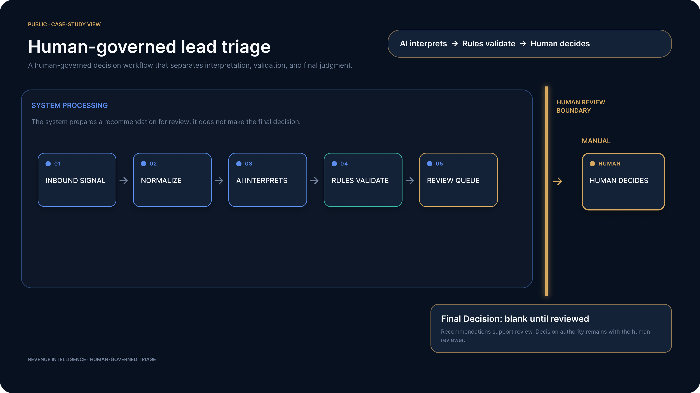

# Inbound Lead Capture & Smart Triage

**Marketing Intelligence** · A specific inbound lead-triage application that organises submitted information and turns a prospect's free-text message into a validated, advisory recommendation for human review.

## Business Application

Marketing and revenue teams may need to qualify and process inbound requests when the available information is incomplete, inconsistent, or difficult to interpret. In a lightweight form-based intake process, manual first review can also vary from one request to another.

Scenario 01 demonstrates one implementation pattern for that problem. It accepts an inbound submission, interprets the free-text Message, validates the proposed triage outcome, and creates a structured review item. The final decision and any Marketing-to-Sales action remain with a human reviewer.

This case study does not define the full Marketing Intelligence domain. Broader Marketing Intelligence solutions may use deterministic, AI-assisted, or hybrid decision logic depending on the business problem, predefined rules, uncertainty, consequence, and required human oversight. Scenario 01 specifically uses **AI interprets → Rules validate → Human decides**.

## Who It Helps

- Marketing Ops
- Demand Generation
- Growth
- RevOps
- Sales Ops

## Potential Operational Value

This implementation pattern may support:

- more consistent initial lead triage;
- less manual interpretation of inbound messages;
- a more structured basis for Marketing-to-Sales handoff decisions;
- better use of the information available in inbound submissions; and
- a smoother, faster initial review process.

These are expected operational benefits, not measured outcomes. The portfolio validation does not establish time savings, conversion impact, customer experience improvement, ROI, or production performance.

| Status | Platforms | Validation data |
| --- | --- | --- |
| Implemented and validated | Make and n8n | Frozen synthetic portfolio data |

> **AI interprets → Rules validate → Human decides**

## At a Glance

| | |
| --- | --- |
| **Input** | Name, Work Email, Company, and Message |
| **AI input** | Message only |
| **Approved outcomes** | `Ready for Handoff`, `Needs Review`, `Not Relevant` |
| **Operational output** | Airtable human-review queue |
| **Decision owner** | Human reviewer |
| **Validated implementations** | Make and n8n |
| **Not included** | Lead scoring, external enrichment, automatic Sales handoff, notifications |

## Architecture



```text
Inbound Signal
      ↓
Normalize
      ↓
AI Interprets
      ↓
Rules Validate
      ↓
Review Queue
      ↓
Human Review Boundary
      ↓
Human Decides
```

> The control model is intentionally simple: **AI interprets → Rules validate → Human decides.**

## Decision Contract

### Input and business rules

The canonical lead input contains Name, Work Email, Company, and Message. Only the free-text **Message** is sent to the language model.

The workflow does not infer company size, revenue, employee count, budget, seniority, business model, or other unavailable attributes. It does not enrich the lead with external data.

The only approved recommendations are:

- `Ready for Handoff`
- `Needs Review`
- `Not Relevant`

### AI role

AI performs a genuine language-understanding task: it interprets the meaning of an inbound message and returns an advisory triage recommendation with a concise reason.

Deterministic workflow logic then checks the parsed recommendation against the approved vocabulary. AI does not own the final business decision.

### Human-review boundary

Each valid automated result reaches an Airtable review queue where the reviewer can see the source submission and AI recommendation. `Review Status` begins as `Pending Review`; `Final Decision` remains human-owned and may differ from the AI recommendation.

There is no automatic Marketing-to-Sales handoff in the validated MVP.

## Implementations

### Make

The validated Make implementation uses six meaningful automation steps:

```text
Synthetic Lead Fixtures
→ Parse Lead Fixtures
→ Gemini Triage
→ Parse AI Triage
→ Validate Recommendation
→ Airtable Human Review Queue
→ Human Final Decision
```

Make orchestrates the synthetic input, parsing, Gemini request, response parsing, deterministic recommendation validation, and Airtable record creation.

> **Documented limitation:** malformed AI JSON can fail at the parsing step and require manual investigation or retry. Automatic exception routing for this case was not implemented in the Make MVP.

### n8n

The validated n8n implementation uses five workflow nodes followed by manual human review:

```text
Manual Test
→ Frozen Test Fixtures
→ AI Message Triage
→ Parse & Validate AI Triage
→ Create Review Record
→ Human Final Decision
```

The n8n implementation preserves the same business contract in its own platform structure. Its deterministic safeguard was tested with an intentionally unsupported recommendation: `Hot Lead` was converted to `Needs Review`.

### Equivalent controls, different failure handling

Both implementations preserve:

- Message-only AI processing;
- the same three approved recommendation outcomes;
- deterministic validation of parsed AI recommendations;
- an operational human-review queue; and
- human ownership of the final decision.

They preserve equivalent business outcomes and safeguards, not identical internal structures. The validated n8n implementation routes unsupported or unparseable AI output toward `Needs Review` through its validation logic. In the current Make MVP, malformed JSON can fail at the parsing step and require manual investigation or retry.

## Validation Evidence

| Case | Scenario | Expected | Observed |
| --- | --- | --- | --- |
| Alex Martin | Clear B2B evaluation interest | Ready for Handoff | Ready for Handoff |
| Jamie Bernard | Ambiguous request for information | Needs Review | Needs Review |
| Taylor Smith | Vendor offering SEO services | Not Relevant | Not Relevant |

The three canonical cases reached the expected recommendation in the validated workflows. The human-review boundary was also validated: the automated recommendation remains separate from the reviewer-owned final decision.

The n8n unsupported-label fallback was additionally validated with `Hot Lead → Needs Review`.

> These tests demonstrate functional behavior for frozen synthetic cases. They are **not** a statistical AI-accuracy benchmark, a production-performance measurement, or evidence of customer outcomes.

## Responsible AI and Data Minimization

The portfolio implementation applies the following safeguards:

- Validation uses synthetic portfolio data.
- Only the inbound Message is sent to the LLM.
- Name, Work Email, and Company remain outside the model request.
- Unavailable information is neither enriched nor inferred.
- No numerical lead score is generated.
- AI output is constrained to an operational contract and validated before use.
- The AI recommendation and human final decision remain separate.
- Consequential downstream action remains human-controlled.

These are implementation safeguards and responsible-AI design choices. They are **not claims of GDPR, EU AI Act, or other regulatory compliance**.

## Stack

| Component | Role |
| --- | --- |
| Make | Workflow orchestration for the Make implementation |
| n8n | Workflow orchestration for the n8n implementation |
| Google Gemini | Semantic interpretation of the inbound Message |
| Airtable | Lightweight operational human-review queue |
| Synthetic fixtures | Portfolio validation data |

The portfolio tools demonstrate the workflow pattern rather than prescribe a client's production stack.

## Client Adaptation and Production Limitations

A client implementation would need to fit the client's source of truth, approved AI stack, and review process. Depending on the context, a production deployment could also require:

- authenticated live form, webhook, CRM, or marketing-platform ingestion;
- explicit AI failure handling and retry policies;
- duplicate prevention and idempotency controls;
- monitoring and operational failure alerts;
- access control, auditability, logging, and retention policies;
- credential and model/prompt lifecycle management;
- privacy, security, and data-processing assessment for real prospect data; and
- broader evaluation with representative and authorized data.

These are production-hardening or client-adaptation considerations, **not functionality claimed as implemented** in Scenario 01.

## Scope

| Implemented and validated | Intentionally out of scope |
| --- | --- |
| Inbound synthetic lead processing | External lead enrichment |
| Semantic Message triage | Numerical lead scoring |
| Three approved recommendation outcomes | Automatic Marketing-to-Sales handoff |
| Deterministic recommendation validation | Notifications |
| Airtable human-review queue | Production CRM integration |
| Human-owned final decision | Production deployment |
| Make and n8n implementations | Measured ROI or customer outcomes |
| Three frozen functional test cases | Regulatory-compliance claims |
| n8n unsupported-label fallback test | |

## Public / Private Boundary

This public case study presents the validated architecture, decisions, safeguards, and results. It intentionally does not publish reconstruction-level implementation details, including complete prompts, raw workflow exports, exact mappings, expressions, resource IDs, credentials, or private technical evidence.
